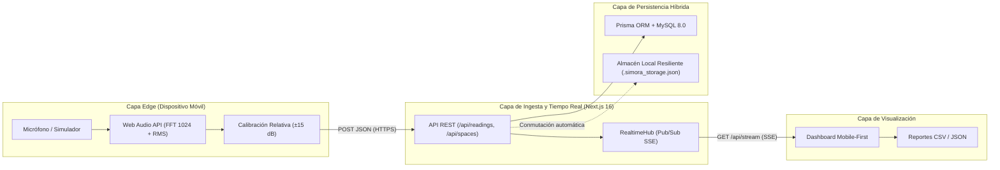
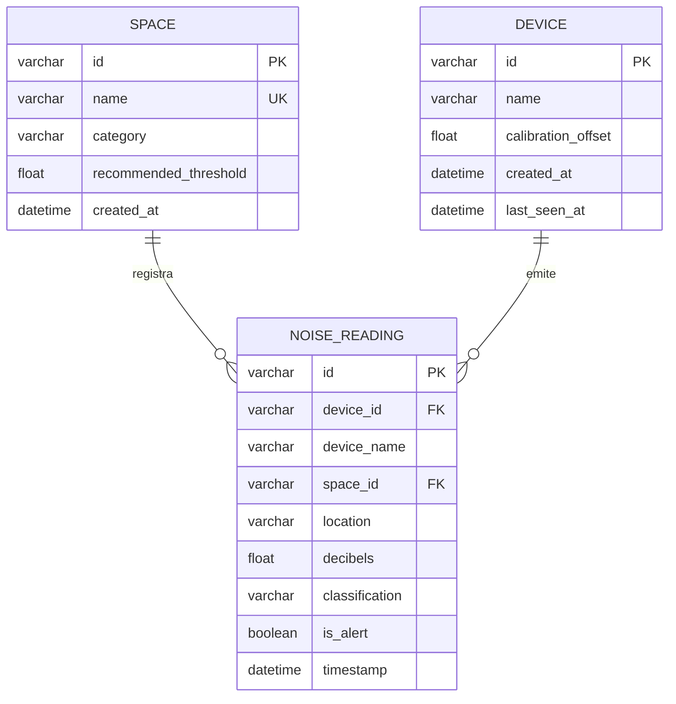

# Manual del Sistema — SIMORA

**Sistema de Monitoreo de Ruido Ambiental mediante Sensores Móviles (IoT)**  
**Institución:** Fundación Universitaria Compensar (2026)  
**Autores:** Sebastian Hernandez Pinzon · Samuel Felipe Barbosa Ríos  

---

## 1. Visión Arquitectónica (Edge-to-Cloud)

SIMORA implementa una arquitectura distribuida de cuatro capas que convierte teléfonos inteligentes y navegadores modernos en nodos sensores acústicos de borde (*Edge Nodes*), eliminando el costo de adquisición de microcontroladores físicos y preservando la privacidad de los ocupantes.

---

## 2. Procesamiento Acústico en el Borde y Privacidad

El archivo `src/lib/audio-meter.ts` procesa la señal acústica íntegramente en la memoria volátil del navegador:

1. **Captura sin filtros distorsionantes:** Se solicita `navigator.mediaDevices.getUserMedia` desactivando `echoCancellation`, `noiseSuppression` y `autoGainControl` para conservar la presión sonora real captada por el micrófono.
2. **Cálculo del Valor Eficaz (RMS):** Sobre una ventana de `fftSize = 1024` muestras en dominio temporal ($x_i \in [-1, 1]$):
   $$\text{RMS} = \sqrt{\frac{1}{N}\sum_{i=1}^{N} x_i^2}$$
3. **Conversión Logarítmica y Suavizado Exponencial:**
   $$L_{\text{raw}} = 20 \cdot \log_{10}(\text{RMS}) + 92\text{ dB}$$
   Se aplica un filtro de media móvil exponencial ($\alpha = 0.22$) seguido del factor de compensación del dispositivo ($\Delta_{\text{cal}} \in [-15, +15]\text{ dB}$):
   $$L_{\text{final}} = \text{clamp}(L_{\text{suavizado}} + \Delta_{\text{cal}}, 25, 120)$$
4. **Análisis Espectral FFT:** Se agrupan las componentes de frecuencia en 18 bandas normalizadas para alimentar el vúmetro dinámico.
5. **Garantía Zero-Recording:** Ningún fragmento PCM ni grabación de voz es almacenado en disco ni transmitido por red; únicamente viaja el escalar numérico en decibeles.

---

## 3. Modelo de Datos Relacional (MySQL + Prisma ORM)

El esquema relacional definido en `prisma/schema.prisma` consta de tres entidades principales indexadas para consultas temporales y espaciales:

### Resiliencia Operativa (Conmutación Automática)
El módulo `src/lib/prisma.ts` verifica la disponibilidad del servidor MySQL con un tiempo límite de `1.5 s`. Si el motor MySQL no está accesible en entornos locales de evaluación rápida, `src/lib/storage.ts` conmuta de manera transparente hacia `.simora_storage.json` sin interrumpir la captura ni el monitoreo.

---

## 4. Referencia de Endpoints (API REST + SSE)

| Método | Ruta | Descripción | Parámetros Principales |
| :--- | :--- | :--- | :--- |
| `GET` | `/api/readings` | Consulta lecturas históricas ordenadas descendentemente. | `limit`, `location`, `classification`, `deviceId`, `from`, `to`, `alertsOnly`, `threshold` |
| `POST` | `/api/readings` | Ingesta una lectura acústica validada (0–140 dB) y notifica por SSE. | Body JSON: `deviceId`, `deviceName`, `location`, `decibels`, `calibrationOffset`, `alertThreshold` |
| `DELETE` | `/api/readings` | Restablece el historial al conjunto de datos base. | Ninguno |
| `GET` | `/api/stats` | Calcula KPIs agregados y distribución OMS. | `location`, `from`, `to`, `threshold` |
| `GET` | `/api/spaces` | Lista los espacios monitoreados registrados. | Ninguno |
| `POST` | `/api/spaces` | Registra un nuevo espacio físico de monitoreo. | Body JSON: `name`, `category` (`Biblioteca`, `Estudio`, `Aula`, `Común`) |
| `GET` | `/api/stream` | Canal Server-Sent Events (SSE) para telemetría en tiempo real. | Emite eventos `connected`, `reading:new`, `space:new`, `reading:reset` |
| `GET` | `/api/health` | Diagnóstico operativo del motor de persistencia y clientes SSE activos. | Ninguno |

---

## 5. Criterios de Clasificación Acústica (Directrices OMS)

- **Silencioso (`< 50 dB`):** Confort óptimo para bibliotecas, lectura y concentración profunda.
- **Moderado (`50 dB – 70 dB`):** Actividad académica participativa habitual sin riesgo auditivo.
- **Ruidoso (`> 70 dB`):** Nivel de disconfort acústico, interferencia en la comunicación y fatiga auditiva.
